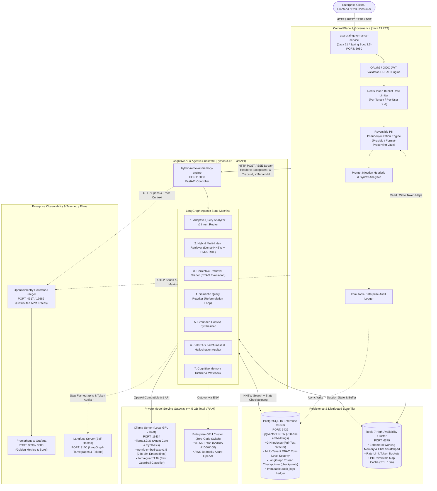
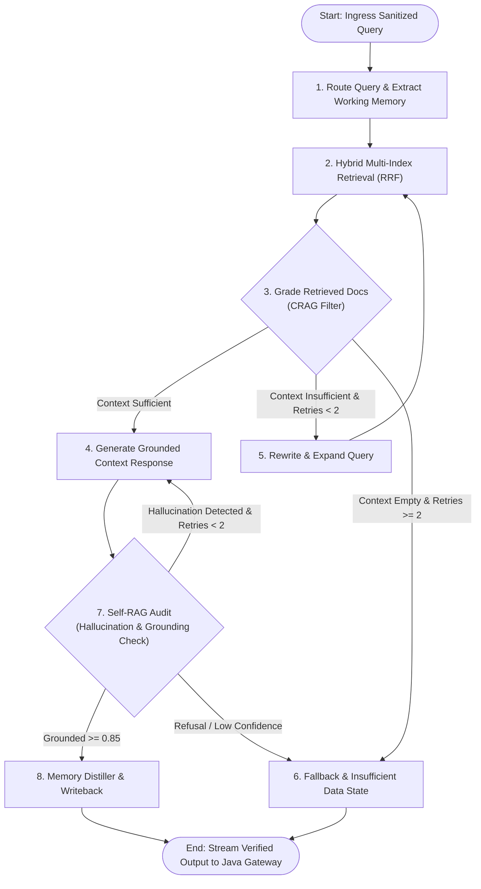
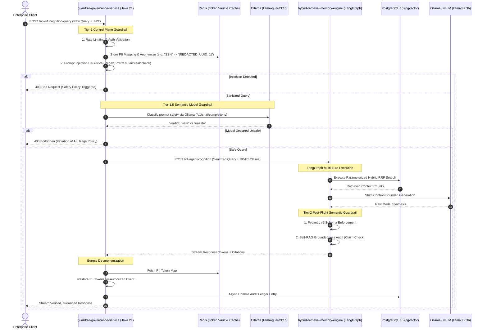
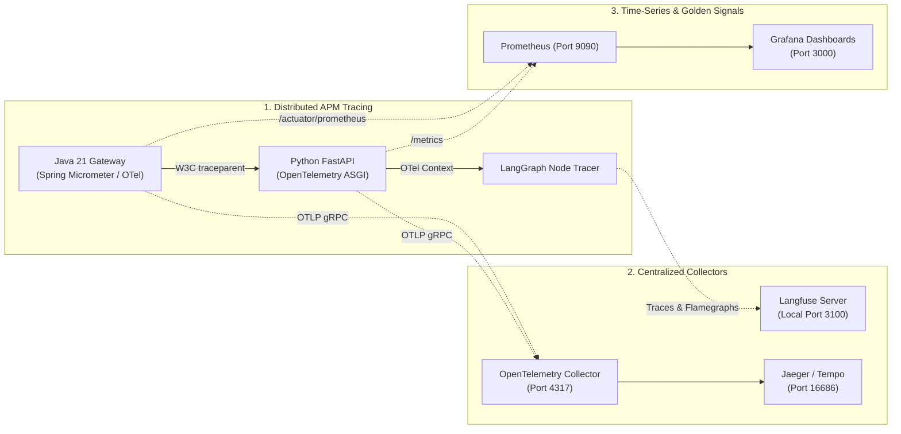

# ENTERPRISE AGENTIC RAG PLATFORM
**Production-Grade Governed Agentic RAG, Cognitive Memory & Adaptive StateGraph System**  
*Java 21 Spring Boot 3.5 · Python 3.12+ FastAPI · LangGraph (StateGraph) · PostgreSQL 16 (pgvector HNSW) · Redis 7 · Local Ollama / Enterprise vLLM*

---

## 1. Project Mission & System Overview

The **Enterprise Agentic RAG Platform** is a production-grade cognitive architecture designed for zero data egress, deterministic compliance, and autonomous self-correction. 

The platform pairs a deterministic Java 21 governance gateway with an asynchronous Python 3.12+ LangGraph agent engine:
1. **Zero-Egress Data Security:** Complete local inference and embedding runtime via self-hosted Ollama (with zero-code cutover to private enterprise vLLM/Triton GPU clusters).
2. **Three-Tier Defense-in-Depth:** Ingress PII reversible pseudonymization and prompt injection defense in Java, semantic safety classification with `llama-guard3:1b` in Ollama, and post-flight grounding/faithfulness verification in Python.
3. **Adaptive StateGraph Cognitive Engine:** Corrective RAG (CRAG) loop with dynamic query rewriting, document relevance grading, and persistent multi-turn thread checkpointing in PostgreSQL.
4. **Multi-Tenant Hybrid RRF Retrieval:** Reciprocal Rank Fusion combining pgvector HNSW dense vector search and PostgreSQL lexical tsvector search with row-level security and security clearance enforcement.
5. **Continuous Quality Benchmarks:** Automated CI/CD gates testing the RAG Triad (Context Relevance ≥ 0.88, Faithfulness ≥ 0.92, Answer Relevance ≥ 0.90).
6. **Full-Stack Enterprise Observability & OpenTelemetry:** Distributed end-to-end tracing across Java, Python, PostgreSQL, and Ollama via W3C `traceparent`, self-hosted Langfuse for LangGraph node flamegraphs and token audits, and Prometheus/Grafana time-series operational metrics.

---

## 2. Platform Architecture & Polyglot Hierarchy



---

## 3. LangGraph Agentic Cognitive Engine Architecture

Rather than executing a single, rigid retrieval-generation chain, the Python tech engine implements an **Adaptive Corrective Agent** compiled with `langgraph.graph.StateGraph`.

### 3.1 Agent State Definition (`CognitionState`)

```python
from typing import Annotated, Sequence, TypedDict, Literal, Optional, Dict, Any, List
from langchain_core.messages import BaseMessage
import operator

class RetrievedDocument(TypedDict):
    id: str
    kind: Literal["episodic", "semantic", "procedural"]
    content: str
    source_reference: str
    confidence: float
    rrf_score: float
    relevance_verdict: Optional[Literal["relevant", "irrelevant"]]

class CognitionState(TypedDict):
    # Execution, Multi-Tenancy & Distributed Tracing Identifiers
    trace_id: str
    traceparent: Optional[str]
    span_id: Optional[str]
    tenant_id: str
    user_id: str
    user_roles: List[str]
    clearance_level: int
    
    # Message History & Prompts
    messages: Annotated[Sequence[BaseMessage], operator.add]
    raw_query: str
    sanitized_query: str
    transformed_query: Optional[str]
    
    # Cognitive Context
    working_memory: Dict[str, Any]
    retrieved_documents: List[RetrievedDocument]
    
    # Agentic Evaluation & Control Flow
    loop_step: int
    max_retries: int
    retrieval_grade: Literal["sufficient", "insufficient", "empty"]
    generated_answer: Optional[str]
    grounding_score: float
    is_grounded: bool
    final_response: Optional[Dict[str, Any]]
```

### 3.2 StateGraph Flow & Conditional Edges



### 3.3 Node Functional Breakdown

1. **`router_node`**: Analyzes the sanitized user prompt, extracts current session scratchpad from Redis (`working_memory`), and decides retrieval scope (Episodic user facts vs. Semantic enterprise documents vs. Procedural instructions).
2. **`retriever_node`**: Executes parameter-safe Reciprocal Rank Fusion combining dense vector similarity (`pgvector` cosine distance) and lexical BM25 (`tsvector` matching), bounded by the caller's `tenant_id` and `clearance_level`.
3. **`grade_documents_node` (Corrective RAG)**: A fast local LLM or cross-encoder evaluates whether each retrieved document is semantically relevant. Irrelevant chunks are pruned; if relevance is below threshold, routes to query rewriting.
4. **`rewrite_query_node`**: Employs an LLM to rephrase the query, resolve ambiguity, and expand synonyms before re-querying the database.
5. **`synthesizer_node`**: Assembles the strict XML-delimited prompt (`<context>`, `<working_memory>`, `<query>`) and prompts Ollama/vLLM using streaming tokens.
6. **`self_rag_auditor_node`**: Compares the claims made in the generated answer against the source chunks to guarantee every claim has explicit textual evidence.
7. **`memory_consolidator_node`**: Asynchronously analyzes if the conversation yielded novel user preferences or facts requiring long-term persistence in the `memories` table.

---

## 4. Multi-Tenant Enterprise Storage Layer & DDL

Location: `infrastructure/postgres/init.sql`

```sql
-- Extensions
CREATE EXTENSION IF NOT EXISTS vector;
CREATE EXTENSION IF NOT EXISTS pgcrypto;

-- 1. Tenants & Security Clearances
CREATE TABLE IF NOT EXISTS tenants (
    id VARCHAR(64) PRIMARY KEY,
    name VARCHAR(255) NOT NULL,
    max_memory_retention_days INTEGER DEFAULT 365,
    created_at TIMESTAMPTZ NOT NULL DEFAULT now()
);

-- 2. Cognitive Memory with Multi-Tenant RBAC & Partitioning
CREATE TABLE IF NOT EXISTS memories (
    id UUID PRIMARY KEY DEFAULT gen_random_uuid(),
    tenant_id VARCHAR(64) NOT NULL REFERENCES tenants(id) ON DELETE CASCADE,
    user_id VARCHAR(64) NOT NULL,
    department_id VARCHAR(64) NOT NULL,
    required_clearance_level INTEGER NOT NULL DEFAULT 1, -- 1=Public, 2=Internal, 3=Confidential, 4=Restricted
    allowed_roles TEXT[] NOT NULL DEFAULT '{"ALL"}',
    
    kind TEXT NOT NULL CHECK (kind IN ('episodic', 'semantic', 'procedural', 'working')),
    content TEXT NOT NULL,
    content_tsv tsvector GENERATED ALWAYS AS (to_tsvector('english', content)) STORED,
    embedding vector(768), -- Matches nomic-embed-text:v1.5 (768-dim)
    
    source_type TEXT NOT NULL CHECK (source_type IN ('conversation', 'document', 'system_observation', 'user_explicit')),
    source_reference TEXT NOT NULL,
    confidence NUMERIC(3,2) NOT NULL CHECK (confidence >= 0.0 AND confidence <= 1.0),
    relevance NUMERIC(3,2) NOT NULL DEFAULT 1.0 CHECK (relevance >= 0.0 AND relevance <= 1.0),
    retention TEXT NOT NULL CHECK (retention IN ('session', 'review_required', 'long_term')),
    status TEXT NOT NULL DEFAULT 'active' CHECK (status IN ('active', 'superseded', 'retracted')),
    superseded_by UUID REFERENCES memories(id) ON DELETE SET NULL,
    revision INTEGER NOT NULL DEFAULT 1,
    
    metadata JSONB NOT NULL DEFAULT '{}'::jsonb,
    created_at TIMESTAMPTZ NOT NULL DEFAULT now(),
    updated_at TIMESTAMPTZ NOT NULL DEFAULT now()
);

-- Indices for Production Multi-Tenant Query Performance
CREATE INDEX IF NOT EXISTS memories_tenant_rbac_idx 
    ON memories (tenant_id, required_clearance_level, status);
CREATE INDEX IF NOT EXISTS memories_tsv_idx 
    ON memories USING GIN(content_tsv);
CREATE INDEX IF NOT EXISTS memories_embedding_hnsw_idx 
    ON memories USING hnsw (embedding vector_cosine_ops)
    WITH (m = 16, ef_construction = 64);

-- 3. LangGraph Thread Checkpoint Ledger
CREATE TABLE IF NOT EXISTS checkpoints (
    thread_id TEXT NOT NULL,
    checkpoint_ns TEXT NOT NULL DEFAULT '',
    checkpoint_id TEXT NOT NULL,
    parent_checkpoint_id TEXT,
    type TEXT,
    checkpoint JSONB NOT NULL,
    metadata JSONB NOT NULL DEFAULT '{}'::jsonb,
    created_at TIMESTAMPTZ NOT NULL DEFAULT now(),
    PRIMARY KEY (thread_id, checkpoint_ns, checkpoint_id)
);

-- 4. Immutable Enterprise Audit Trail
CREATE TABLE IF NOT EXISTS audit_logs (
    id UUID PRIMARY KEY DEFAULT gen_random_uuid(),
    trace_id VARCHAR(64) NOT NULL,
    tenant_id VARCHAR(64) NOT NULL,
    user_id VARCHAR(64) NOT NULL,
    event_type TEXT NOT NULL,
    prompt_raw_length INTEGER NOT NULL,
    prompt_sanitized_length INTEGER NOT NULL,
    pii_entities_detected TEXT[] DEFAULT '{}',
    guardrail_status TEXT NOT NULL CHECK (guardrail_status IN ('CLEAN', 'SANITIZED', 'BLOCKED')),
    guardrail_verdict_notes JSONB DEFAULT '[]'::jsonb,
    retrieved_memory_ids UUID[] DEFAULT '{}',
    evaluation_scores JSONB DEFAULT '{}'::jsonb, -- Context relevance, faithfulness, etc.
    execution_time_ms INTEGER NOT NULL,
    created_at TIMESTAMPTZ NOT NULL DEFAULT now()
);

CREATE INDEX IF NOT EXISTS audit_logs_trace_idx ON audit_logs(trace_id);
CREATE INDEX IF NOT EXISTS audit_logs_tenant_created_idx ON audit_logs(tenant_id, created_at DESC);
```

### 4.1 Parameterized Hybrid Reciprocal Rank Fusion (RRF) Query

```sql
-- Executed asynchronously by Python via asyncpg
WITH vector_search AS (
    SELECT id, ROW_NUMBER() OVER (ORDER BY embedding <=> $1) AS rank
    FROM memories
    WHERE tenant_id = $2
      AND status = 'active'
      AND required_clearance_level <= $3
      AND (allowed_roles && $4 OR 'ALL' = ANY(allowed_roles))
    LIMIT 25
),
text_search AS (
    SELECT id, ROW_NUMBER() OVER (ORDER BY ts_rank_cd(content_tsv, plainto_tsquery('english', $5)) DESC) AS rank
    FROM memories
    WHERE tenant_id = $2
      AND status = 'active'
      AND required_clearance_level <= $3
      AND (allowed_roles && $4 OR 'ALL' = ANY(allowed_roles))
      AND content_tsv @@ plainto_tsquery('english', $5)
    LIMIT 25
)
SELECT 
    m.id,
    m.kind,
    m.content,
    m.source_reference,
    m.confidence,
    COALESCE(1.0 / (60 + v.rank), 0.0) + COALESCE(1.0 / (60 + t.rank), 0.0) AS rrf_score
FROM memories m
LEFT JOIN vector_search v ON m.id = v.id
LEFT JOIN text_search t ON m.id = t.id
WHERE v.id IS NOT NULL OR t.id IS NOT NULL
ORDER BY rrf_score DESC
LIMIT $6;
```

---

## 5. Three-Tier Defense-in-Depth Guardrail System



---

## 6. Directory Structure & Complete Code Layout

```
enterprise-agentic-rag-platform/
├── docker-compose.yml
├── .env.example
├── contracts/
│   ├── openapi/
│   │   ├── core-api-v1.yaml
│   │   └── memory-service-v1.yaml
│   └── events/
│       ├── memory.created.v1.json
│       └── audit.entry.v1.json
├── infrastructure/
│   ├── postgres/
│   │   ├── init.sql
│   │   └── postgresql.conf
│   ├── redis/
│   │   └── redis.conf
│   └── telemetry/
│       ├── docker-compose.telemetry.yml           # Self-hosted Langfuse, OTel Collector, Prometheus, Jaeger
│       ├── otel-collector-config.yaml
│       └── prometheus.yml
├── services/
│   ├── core-api/                                  # Java 21 Spring Boot 3.5 Control Plane
│   │   ├── pom.xml                                # Micrometer, OTel bridge, Actuator, Prometheus
│   │   └── src/main/java/com/enterprisrag/governance/
│   │       ├── CoreApiApplication.java
│   │       ├── config/
│   │       │   ├── SecurityConfig.java
│   │       │   ├── RedisConfig.java
│   │       │   ├── WebFluxConfig.java
│   │       │   ├── OpenTelemetryConfig.java        # W3C traceparent propagation & OTLP exporter
│   │       │   └── ResilienceConfig.java
│   │       ├── controller/
│   │       │   ├── CognitionGatewayController.java # Supports SSE streaming & standard POST
│   │       │   └── HealthController.java
│   │       ├── dto/
│   │       │   ├── ClientQueryRequest.java
│   │       │   ├── SanitizedServicePayload.java
│   │       │   └── StreamedTokenChunk.java
│   │       ├── guardrails/
│   │       │   ├── PiiVaultService.java            # Reversible tokenization engine
│   │       │   ├── PromptInjectionDetector.java    # Heuristic and delimiter scanner
│   │       │   ├── LocalModelGuardClient.java      # Ollama llama-guard3:1b client
│   │       │   └── GuardrailOutcome.java
│   │       └── service/
│   │           ├── CognitionStreamingClient.java   # Spring 6 Reactive WebClient for SSE
│   │           └── AuditLedgerService.java
│   └── memory-service/                            # Python 3.12+ FastAPI & LangGraph Substrate
│       ├── pyproject.toml
│       ├── requirements.txt
│       └── app/
│           ├── __init__.py
│           ├── main.py
│           ├── config.py
│           ├── api/
│           │   ├── v1/
│           │   │   ├── cognition.py               # SSE stream endpoint & batch endpoint
│           │   │   └── memories.py
│           ├── core/
│           │   ├── database.py                    # asyncpg connection pooling
│           │   ├── redis_client.py
│           │   ├── telemetry.py                   # OpenTelemetry OTLP instrumentation & Langfuse tracer
│           │   └── model_client.py                # httpx client with fallback & retry
│           ├── graph/                             # LangGraph Agent Engine
│           │   ├── __init__.py
│           │   ├── state.py                       # CognitionState & TypedDicts
│           │   ├── nodes.py                       # Router, Retriever, Grader, Synthesizer
│           │   ├── edges.py                       # Conditional routing & retry evaluators
│           │   ├── workflow.py                    # StateGraph builder and compilation
│           │   └── checkpointer.py                # AsyncPostgresSaver checkpointer
│           ├── guardrails/
│           │   ├── schema_validator.py            # Pydantic v2 strict schema enforcement
│           │   ├── self_rag_auditor.py            # Faithfulness & Groundedness check
│           │   └── egress_leakage_filter.py       # Prompt & delimiter leak prevention
│           ├── memory/
│           │   ├── hybrid_retriever.py            # Asyncpg RRF execution
│           │   ├── consolidation_worker.py        # Background task for memory clustering
│           │   └── models.py
│           └── schemas/
│               ├── cognition.py
│               └── memory.py
└── tests/
    ├── load/
    │   └── locustfile.py                          # 50 concurrent user stress test
    ├── unit/
    └── evals/
        ├── benchmark_dataset.json                 # 25 golden enterprise queries
        └── test_rag_triad.py                      # Ragas & DeepEval quality gates
```

---

## 7. Enterprise Observability, Distributed Tracing & Telemetry Architecture

To provide enterprise-grade auditability, operational visibility, and latency monitoring without compromising the zero-data-egress posture, the platform implements a three-tiered telemetry framework:



### 7.1 Distributed APM Tracing (W3C `traceparent` Propagation)
1. **Trace Ingress:** When an enterprise client or API gateway sends a request to `guardrail-governance-service`, Spring Cloud / Micrometer Tracing either extracts the incoming W3C `traceparent` header or generates a new root trace (`trace_id`).
2. **Context Propagation:** When the Java service makes an HTTP/SSE call to `hybrid-retrieval-memory-engine`, it propagates the `traceparent` header (`00-{trace_id}-{span_id}-{flags}`).
3. **Python Ingestion:** FastAPI's `OpenTelemetryMiddleware` extracts the span context so all downstream asynchronous calls (PostgreSQL queries via asyncpg, Ollama model inference) become child spans under the exact same root trace.

### 7.2 LLM & LangGraph Agent Observability (Self-Hosted Langfuse)
Standard APM tools (e.g., Datadog, Jaeger) only measure HTTP latency and cannot visualize iterative agent state graphs. The platform integrates self-hosted **Langfuse** running locally in Docker:
* **Node-by-Node Flamegraphs:** Tracks execution duration and status for every node in the `StateGraph` (`router_node`, `retriever_node`, `grade_documents_node`, `synthesizer_node`, `self_rag_auditor_node`).
* **Token Accounting & Cost Attribution:** Aggregates input prompt tokens, completion tokens, and embedding token volumes attributed per `tenant_id` and `user_id`.
* **Intermediate Prompt/Completion Inspection:** Audits exact inputs and responses at each reflection loop (e.g., whether the query rewriter changed the prompt and why).

### 7.3 Operational Metrics & Golden Signals (Prometheus & Grafana)
* **Spring Boot Actuator:** Exposes `/actuator/prometheus` tracking JVM memory, Redis connection pool health, rate-limiter token availability, and HTTP request percentiles (P50, P95, P99).
* **FastAPI Instrumentation:** Uses `prometheus-fastapi-instrumentator` exposing `/metrics` for active LangGraph executions, database pool wait time, and Time-To-First-Token (TTFT).
* **Ollama GPU/Inference Telemetry:** Tracks model inference durations, tokens-per-second throughput, and VRAM utilization across `llama-guard3:1b`, `nomic-embed-text:v1.5`, and `llama3.2:3b`.

---

## 8. Automated Output Quality Gates (The RAG Triad)

Continuous Integration enforces strict automated quality thresholds before any model or prompt change can be merged:

| Metric | Target SLA | CI Build Failure Threshold | Evaluation Method |
| :--- | :---: | :---: | :--- |
| **Context Relevance** | $\ge 0.88$ | $< 0.75$ | Evaluates ratio of retrieved context chunks strictly useful for synthesizing the answer. |
| **Faithfulness (Groundedness)** | $\ge 0.92$ | $< 0.85$ | Verifies that 100% of factual assertions made in the answer are substantiated by the retrieved context. |
| **Answer Relevance** | $\ge 0.90$ | $< 0.80$ | Ensures the output strictly addresses the prompt without digression. |
| **Time to First Token (TTFT)** | $\le 1.2\text{s}$ | $> 2.5\text{s}$ | Measures latency between client query receipt and initial SSE stream flush. |
| **P95 Total Response Latency** | $\le 4.0\text{s}$ | $> 7.0\text{s}$ | Maximum allowable round-trip duration under 25 concurrent users. |

---

## 9. 4-Week Execution Roadmap

### Week 1: Enterprise Infrastructure, Multi-Tenant Storage & Model Runtimes
* **Day 1: Storage & Runtimes** — Deploy PostgreSQL 16 (`pgvector`), Redis 7 via Docker Compose. Run full `init.sql` schema.
* **Day 2: Local Model Serving & Guard Verification** — Pull `llama3.2:3b`, `nomic-embed-text:v1.5`, and `llama-guard3:1b` via Ollama. Validate HTTP inference (~4.5 GB total VRAM).
* **Day 3: Python Data Engine & Checkpointer** — Implement `database.py` (asyncpg connection pool) and integrate LangGraph `AsyncPostgresSaver`.
* **Day 4: Java Governance Gateway & OpenTelemetry** — Configure Spring Security, Redis token bucket rate limiting, WebFlux, and Micrometer OTel exporter.
* **Day 5: Week 1 Milestone** — End-to-end ping: Java gateway validates JWT $\rightarrow$ forwards to Python $\rightarrow$ completes mock vector lookup.

### Week 2: LangGraph State Machine, Hybrid Search & Three-Tier Guardrails
* **Day 6: LangGraph Agent Graph** — Implement `state.py`, `nodes.py`, `edges.py`, and assemble `StateGraph` with retry routing.
* **Day 7: Hybrid RRF Search & Python Telemetry** — Implement parameterized RRF query with RBAC + FastAPI OpenTelemetry middleware and Langfuse callback setup.
* **Day 8: Tier-1 & Tier-1.5 Guardrails in Java** — Implement `PiiVaultService` (reversible tokenization) and `LocalModelGuardClient` (Ollama Llama Guard).
* **Day 9: Tier-2 Post-Flight Semantic Guardrails** — Implement Self-RAG grounding verification and Pydantic v2 output schemas.
* **Day 10: Week 2 Milestone** — Full closed-loop test: Injection blocked, PII safely pseudonymized, hybrid RRF retrieved, and LangGraph response generated.

### Week 3: Streaming, Memory Consolidation & Quality CI/CD
* **Day 11: SSE Streaming Integration** — Wire token streaming from Ollama $\rightarrow$ FastAPI SSE endpoint $\rightarrow$ Spring WebFlux SSE client $\rightarrow$ Enterprise Client.
* **Day 12: Cognitive Memory Consolidation Worker** — Implement background worker to distill working memory into long-term episodic/semantic records.
* **Day 13: Golden Benchmark & Ragas Test Suite** — Build `benchmark_dataset.json` (25 test cases) and automated `test_rag_triad.py`.
* **Day 14: Quality Regression Thresholds & Dashboards** — Add GitHub Actions workflow failing PRs if Faithfulness drops below 85% + Grafana RAG Triad dashboards.
* **Day 15: Week 3 Milestone** — Automated execution of Ragas evals in CI with passing quality scores.

### Week 4: Cloud Cutover, Load Testing & Production Runbook
* **Day 16: Zero-Code Cloud Cutover Abstraction** — Parameterize environment variables to support seamless switch to vLLM / Triton / Cloud APIs.
* **Day 17: Containerization & Security Hardening** — Multi-stage Dockerfiles (Java 21 Distroless, Python slim non-root).
* **Day 18: Concurrency & Stress Testing** — Execute `locustfile.py` with 50 concurrent streams; tune asyncpg pool and Redis connection limits.
* **Day 19: Disaster Recovery & Failover Testing** — Test Resilience4j circuit breaker by intentionally bringing down Ollama to verify graceful fallback.
* **Day 20: Final Handover & Audit Trail Verification** — Complete compliance verification against `audit_logs` and publish operator runbooks.

---

## 10. Operator Verification Commands & Quickstart

```bash
# 1. Start core data stores & telemetry stack
docker compose up -d postgres redis
docker compose -f infrastructure/telemetry/docker-compose.telemetry.yml up -d

# 2. Pull local models via Ollama (~4.5 GB total VRAM)
ollama pull llama-guard3:1b
ollama pull nomic-embed-text:v1.5
ollama pull llama3.2:3b

# 3. Launch Python hybrid-retrieval-memory-engine with LangGraph
cd services/memory-service
python -m venv .venv
.venv\Scripts\activate          # Windows (source .venv/bin/activate on Linux)
pip install -r requirements.txt
uvicorn app.main:app --host 0.0.0.0 --port 8000 --reload

# 4. Launch Java guardrail-governance-service
cd services/core-api
./mvnw clean spring-boot:run

# 5. Execute Automated Quality Benchmarks
cd services/memory-service
pytest tests/evals/test_rag_triad.py -v -s

# 6. Run Concurrent Load & Stress Test (Locust)
cd tests/load
locust -f locustfile.py --headless -u 25 -r 5 --run-time 1m --host http://localhost:8080

# 7. Telemetry & Observability Endpoints
# Jaeger APM Traces:       http://localhost:16686
# Langfuse LLM Tracing:    http://localhost:3100
# Prometheus Metrics:      http://localhost:9090
# Grafana Dashboards:      http://localhost:3000
```

