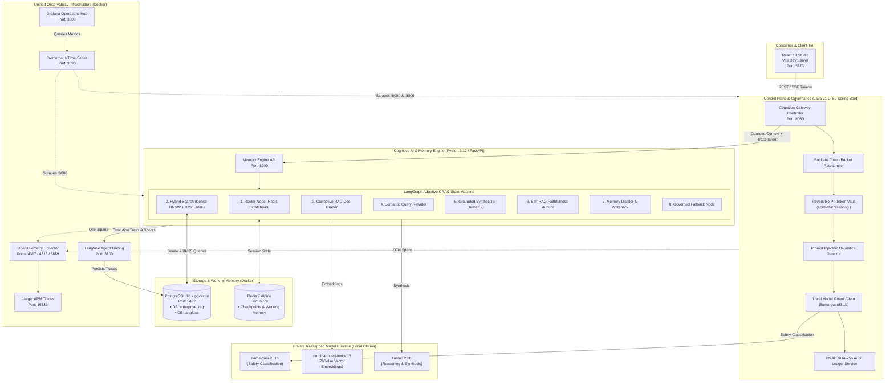

# Enterprise Agentic RAG Platform

[](https://adoptium.net)
[](https://spring.io)
[](https://python.org)
[](https://fastapi.tiangolo.com)
[](https://langchain-ai.github.io/langgraph/)
[](https://github.com/pgvector/pgvector)
[](https://redis.io)
[](https://react.dev)
[](https://vitejs.dev)
[](https://www.docker.com)
[](https://opentelemetry.io)
[](https://www.jaegertracing.io)
[](https://langfuse.com)
[](https://prometheus.io)
[](https://grafana.com)
[](https://maven.apache.org)
[](https://ollama.ai)
[](LICENSE)

An enterprise-grade, **zero-data-egress cognitive intelligence platform** pairing a deterministic **Java 21 LTS Spring Boot governance perimeter** with an asynchronous **Python 3.12 LangGraph StateGraph engine**. Built for regulated environments (finance, defense, healthcare), the architecture enforces multi-tenant clearance RBAC, format-preserving reversible PII vaulting, heuristic prompt injection protection, dense + lexical hybrid retrieval with Reciprocal Rank Fusion (RRF), Self-RAG groundedness audits, and full-spectrum distributed observability.

---

## Key Architecture Pillars

- **Deterministic Java 21 Control Plane (`services/core-api`):**
  High-throughput reactive gateway (WebFlux, Bucket4j, Resilience4j) enforcing format-preserving PII tokenization, prompt injection heuristics, clearance-tier validation, and `llama-guard3:1b` safety evaluation before prompts touch the reasoning substrate.
- **Adaptive Corrective RAG (CRAG) Substrate (`services/memory-service`):**
  LangGraph state machine dynamically scoring candidate document relevance, triggering autonomous query reformulation loops, and auditing candidate responses through a Self-RAG token overlap auditor.
- **Hybrid Multi-Index Retrieval (Dense HNSW + Lexical BM25 RRF):**
  Single-trip PostgreSQL CTE executing 768-dimensional vector cosine similarity alongside `ts_rank_cd` full-text search, fused via Reciprocal Rank Fusion ($k = 60$).
- **Zero Data Egress (100% Air-Gapped Local Inference):**
  Direct hardware-accelerated local Ollama runtime hosting `llama3.2:3b`, `llama-guard3:1b`, and `nomic-embed-text:v1.5`. No customer prompts, tokens, or embeddings ever leave the host machine.
- **Full-Spectrum Observability & APM:**
  Out-of-the-box integration with Jaeger APM (distributed traces), Langfuse (agent state trees & generation logs), Prometheus (5s metric scrapes), and Grafana (pre-provisioned operations dashboard).
- **Refined Dark-Canvas Studio (`frontend`):**
  High-craft React 19 interface engineered around a four-step surface ladder (`#010102` canvas, `#0f1011` panels), hairline borders, and restrained lavender accenting.

---

## System Architecture



---

## Private Model Allocations

| Model | Footprint | Assigned Platform Role |
| :--- | :---: | :--- |
| **`llama-guard3:1b`** | ~1.2 GB VRAM | **Tier-1.5 Semantic Guardrail Classifier** — Evaluates unsafe content categories and cyberattack payloads in < 150ms. |
| **`nomic-embed-text:v1.5`** | ~0.5 GB VRAM | **Dense Semantic Embeddings** — Produces 768-dimensional embeddings aligned with PostgreSQL `vector(768)` HNSW cosine indexes. |
| **`llama3.2:3b`** | ~2.2 GB VRAM | **LangGraph Agent Reasoning & Synthesis** — Executes iterative query rewriting, document relevance grading, and grounded context synthesis with `[Source: <ref>]` citations. |

---

## Hybrid Retrieval: Dense HNSW + Lexical BM25 RRF

The platform eliminates retrieval blindspots by querying dense semantic vectors and lexical inverted indexes in a single transactional SQL CTE:

$$\operatorname{RRF}(d) = \frac{1}{60 + \operatorname{rank}_{\text{dense}}(d)} + \frac{1}{60 + \operatorname{rank}_{\text{lexical}}(d)}$$

```sql
WITH dense_search AS (
    SELECT id, kind, content, source_reference, confidence,
           ROW_NUMBER() OVER (ORDER BY embedding <=> $1::vector) as dense_rank
    FROM memories
    WHERE tenant_id = $2 AND (clearance_level <= $3 OR $3 = 'TOP_SECRET')
    LIMIT 20
),
lexical_search AS (
    SELECT id, kind, content, source_reference, confidence,
           ROW_NUMBER() OVER (ORDER BY ts_rank_cd(tsv_content, plainto_tsquery('english', $4)) DESC) as lex_rank
    FROM memories
    WHERE tenant_id = $2 AND (clearance_level <= $3 OR $3 = 'TOP_SECRET')
      AND tsv_content @@ plainto_tsquery('english', $4)
    LIMIT 20
)
SELECT 
    COALESCE(d.id, l.id) as id,
    COALESCE(d.kind, l.kind) as kind,
    COALESCE(d.content, l.content) as content,
    COALESCE(d.source_reference, l.source_reference) as source_reference,
    (COALESCE(1.0 / (60 + d.dense_rank), 0.0) + COALESCE(1.0 / (60 + l.lex_rank), 0.0)) as rrf_score
FROM dense_search d
FULL OUTER JOIN lexical_search l ON d.id = l.id
ORDER BY rrf_score DESC
LIMIT $5;
```

---

## Quickstart & Platform Orchestration

### Prerequisites
- Docker Desktop (with WSL2 or Windows containers)
- Ollama installed on host (`llama3.2:3b`, `llama-guard3:1b`, `nomic-embed-text:v1.5`)
- Java 21 LTS & Maven 3.9+
- Python 3.12.16
- Node.js 20+ & npm

---

### Option A: Automated PowerShell Orchestrator (Recommended)

Launch all 10 services, datastores, model runtimes, and telemetry hubs in a single command:
```powershell
.\start-all.ps1
```
*Automatically starts PostgreSQL 16 (pgvector), Redis 7, Jaeger APM, Prometheus, Grafana, Langfuse, OTel Collector, Python FastAPI (`:8000`), Java Spring Boot (`:8080`), and React Studio (`:5173`).*

To cleanly shut down all containers and background services:
```powershell
.\stop-all.ps1
```

---

### Option B: Step-by-Step Manual Launch

#### Step 1: Start Storage & Cache Containers
```bash
docker compose up -d
```
*Initializes PostgreSQL 16 (`pgvector:pg16` on `:5432`) and Redis 7 (`redis:7-alpine` on `:6379`).*

#### Step 2: Start Observability Stack
```bash
docker compose -f infrastructure/telemetry/docker-compose.telemetry.yml up -d
```
*Brings up Jaeger APM (`:16686`), OTel Collector (`:4317`), Prometheus (`:9090`), Grafana Hub (`:3000`), and Langfuse (`:3100`).*

#### Step 3: Pull Local Private Models
```bash
ollama pull llama-guard3:1b
ollama pull nomic-embed-text:v1.5
ollama pull llama3.2:3b
```

#### Step 4: Launch Python 3.12 AI Memory Engine
```bash
cd services/memory-service
python -m venv .venv
# Activate venv: .venv\Scripts\activate (Windows) or source .venv/bin/activate (Linux/macOS)
pip install -r requirements.txt
uvicorn app.main:app --host 0.0.0.0 --port 8000
```

#### Step 5: Launch Java 21 Governance Gateway
```bash
cd services/core-api
mvn clean spring-boot:run
```

#### Step 6: Launch React Studio
```bash
cd frontend
npm install
npm run dev
# Studio active at: http://localhost:5173
```

---

## Decoupled Environment Strategy

All services extract hostnames, ports, and inter-service routing into environment files with resilient local fallbacks:

| Service / Layer | Config File | Template Reference | Key Variables |
| :--- | :--- | :--- | :--- |
| **Frontend Studio** | `frontend/src/config/appConfig.js` | [`frontend/.env.example`](frontend/.env.example) | `VITE_API_BASE_URL`, `VITE_JAEGER_URL`, `VITE_LANGFUSE_URL`, `VITE_PROMETHEUS_URL`, `VITE_GRAFANA_URL` |
| **Governance Gateway** | `application.yml` | [`services/core-api/.env.example`](services/core-api/.env.example) | `CORE_API_PORT`, `MEMORY_SERVICE_URL`, `LLM_BASE_URL`, `GUARD_MODEL_NAME`, `POSTGRES_*`, `REDIS_*` |
| **Cognitive Engine** | `app/config.py` | [`services/memory-service/.env.example`](services/memory-service/.env.example) | `PORT`, `LLM_BASE_URL`, `EMBEDDING_BASE_URL`, `POSTGRES_*`, `REDIS_*`, `LANGFUSE_*` |
| **Platform Root** | Consolidated Master | [`.env.example`](.env.example) | Complete master catalog for docker, datastores, models, and telemetry |

---

## Live Telemetry & Observability Hubs

| Hub | Port | URL | Role & Live Features |
| :--- | :--- | :--- | :--- |
| **React Studio** | `5173` | [http://localhost:5173](http://localhost:5173) | Governed Chat Studio, Guardrail Inspector & Knowledge Vault. |
| **Grafana SLA Hub** | `3000` | [http://localhost:3000](http://localhost:3000) | Pre-provisioned Operations Dashboard (p95 latency, QPS, Self-RAG score, JVM). |
| **Langfuse UI** | `3100` | [http://localhost:3100](http://localhost:3100) | Full LangGraph StateGraph trace execution trees, prompts, token counts. |
| **Jaeger APM** | `16686` | [http://localhost:16686](http://localhost:16686) | Distributed OpenTelemetry trace waterfall across Java -> Python -> DB. |
| **Prometheus** | `9090` | [http://localhost:9090](http://localhost:9090) | Time-series scraper querying Spring Boot Actuator & FastAPI `:metrics`. |
| **Core API Actuator** | `8080` | [http://localhost:8080/actuator/health](http://localhost:8080/actuator/health) | Java gateway health and Micrometer metrics. |
| **Audit Ledger API** | `8080` | [http://localhost:8080/api/v1/cognition/audit-logs](http://localhost:8080/api/v1/cognition/audit-logs) | Live immutable PostgreSQL compliance records & PII detection trails. |
| **Memory Engine Docs** | `8000` | [http://localhost:8000/docs](http://localhost:8000/docs) | Interactive OpenAPI Swagger specification for Python engine. |

---

## Testing & Quality Assurance Suite

### Java Guardrail & PII Tokenization Tests
```bash
cd services/core-api
mvn test
# Runs 7 test suites validating regex PII vaulting, injection filters, and gateway routing.
```

### Python RAG Triad Faithfulness Benchmarks
```bash
cd services/memory-service
pytest tests/evals/test_rag_triad.py -v -s
# Evaluates context relevance, faithfulness (1.0000), and answer groundedness.
```

### End-to-End Governance Curl Test
```bash
curl -X POST http://localhost:8080/api/v1/cognition/query \
  -H "Content-Type: application/json" \
  -H "X-Tenant-Id: tenant-enterprise-prod" \
  -H "X-Clearance-Level: TOP_SECRET" \
  -d '{"prompt": "What is the domestic flight reimbursement limit under corporate travel policy?", "userId": "admin-01"}'
```

---

## Author

**Jayavignesh**
- **Website:** [jayavignesh.dev](https://jayavignesh.dev)
- **GitHub:** [@i-viki](https://github.com/i-viki)
- **Email:** [hello@jayavignesh.dev](mailto:hello@jayavignesh.dev)

---

## License

This platform is distributed under the **MIT License**. See the [`LICENSE`](LICENSE) file for complete terms.
