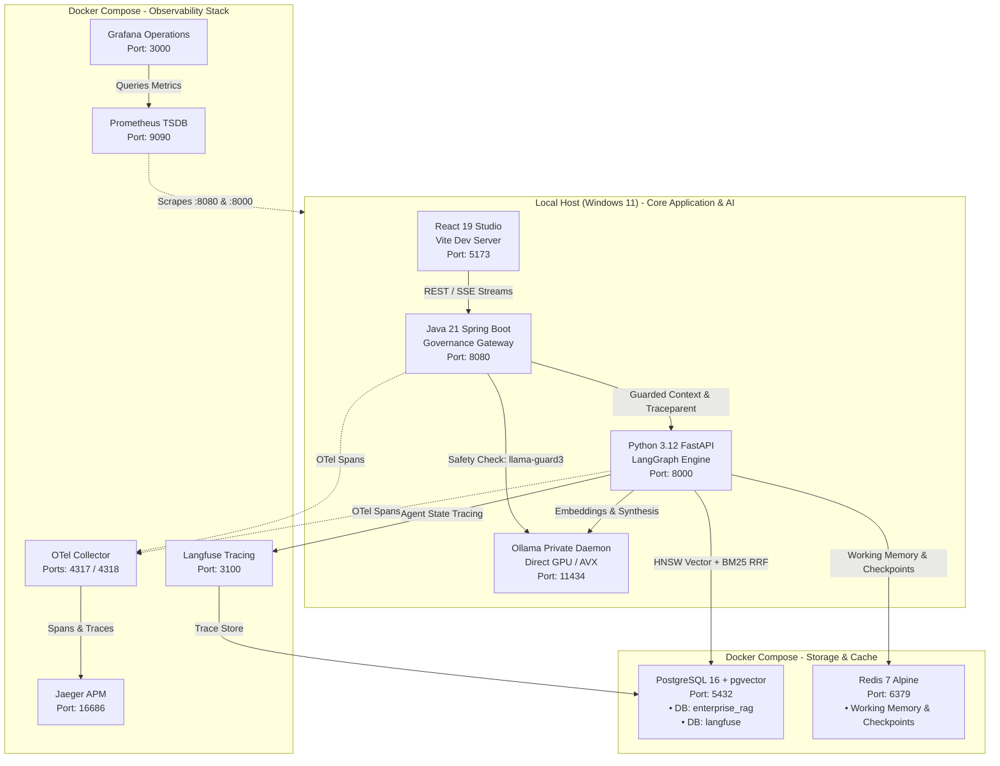
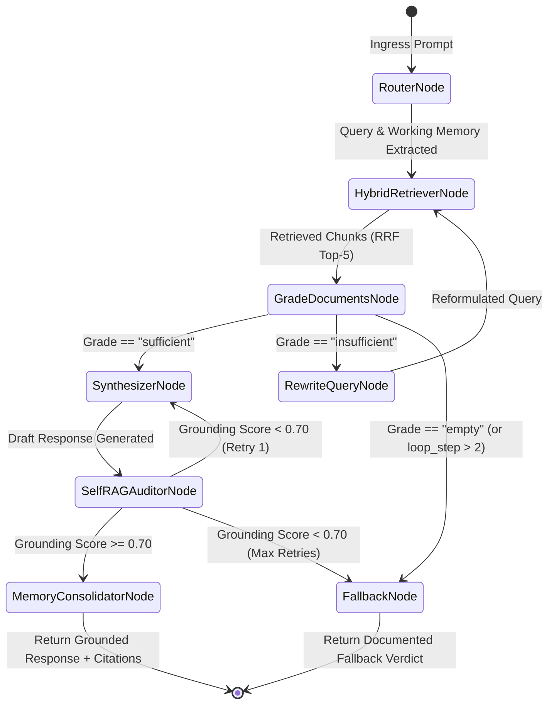
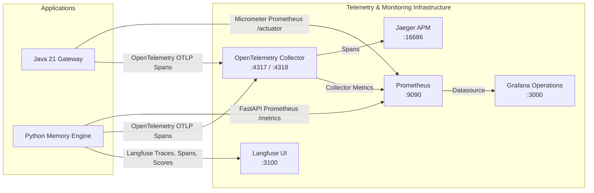

# Enterprise Agentic RAG Platform — System Architecture & Specification

## 1. Executive Summary & Core Philosophy

The **Enterprise Agentic RAG Platform** is a dual-tier, air-gapped cognitive intelligence system built to deliver autonomous, highly governed Retrieval-Augmented Generation across multi-tenant enterprise data. 

The platform guarantees:
1. **Zero External Data Egress:** All models (`llama3.2:3b`, `llama-guard3:1b`, and `nomic-embed-text:v1.5`) run on local hardware through Ollama without transmitting telemetry, prompts, or embeddings across the public internet.
2. **Deterministic Governance & Ingress Protection:** High-throughput security controls implemented in **Java 21 LTS Spring Boot** tokenize PII, detect adversarial prompt injections, and enforce clearance-level RBAC before prompts enter the reasoning engine.
3. **Adaptive Corrective RAG (CRAG) StateGraph:** Orchestrated by **Python 3.12 FastAPI** and **LangGraph**, the system dynamically assesses retrieval adequacy, reformulates queries if relevance is insufficient, and executes a Self-RAG groundedness audit before emitting responses.
4. **Full-Spectrum Observability:** Unified telemetry spanning distributed APM traces (Jaeger), agent state execution trees (Langfuse), scrape-based metrics (Prometheus), and pre-provisioned SLA operations dashboards (Grafana).

---

## 2. Platform Topology: Hybrid Host & Container Architecture

To combine the **maximum possible inference speed and hot-reload developer agility** with **rock-solid database and telemetry isolation**, the platform utilizes a hybrid topology:



### Boundary Communication Matrix

| Source | Destination | Protocol | Host / Address | Purpose |
| :--- | :--- | :--- | :--- | :--- |
| React UI | Java Gateway | HTTP / SSE | `http://localhost:8080` | Client query requests & real-time token streaming |
| Java Gateway | Python Engine | HTTP / REST | `http://localhost:8000` | Sanitized prompt forwarding with clearance metadata |
| Java / Python | Ollama Daemon | HTTP REST | `http://localhost:11434` | Direct GPU inference for safety, embeddings, and chat |
| Python Engine | PostgreSQL 16 | TCP (asyncpg) | `localhost:5432` | pgvector HNSW dense vector search & BM25 lexical query |
| Python Engine | Redis 7 | TCP (redis-py)| `localhost:6379` | Thread checkpoints and ephemeral working memory |
| Python Engine | Langfuse | HTTP / REST | `http://localhost:3100` | Agent state graph execution trees, spans, and scores |
| Java & Python | OTel Collector | gRPC (OTLP) | `localhost:4317` | Distributed distributed trace spans |
| Docker Prometheus| Java Gateway | HTTP Scrape | `host.docker.internal:8080`| Micrometer Actuator metrics (`/actuator/prometheus`) |
| Docker Prometheus| Python Engine| HTTP Scrape | `host.docker.internal:8000`| Prometheus FastAPI metrics (`/metrics`) |
| Docker Langfuse | PostgreSQL 16 | TCP | `host.docker.internal:5432`| Dedicated telemetry database (`langfuse`) storage |

---

## 3. Component Deep Dive

### 3.1. Java 21 LTS Governance Gateway (`services/core-api`)
The Java control plane serves as the authoritative front door, enforcing enterprise compliance before any downstream generative AI invocation:

1. **PII Vault Service (`PiiVaultService.java`):**
   - Ingress regex and pattern matching scans for Social Security Numbers (SSN), credit card numbers, email addresses, and phone numbers.
   - Matches are replaced with deterministic reversible tokens: `<PII:TOKEN:xxxxxxxxxxxx>`.
   - The token mapping is stored securely in the Postgres fallback vault (`pii_token_vault`) or local in-memory cache, ensuring unmasked PII never reaches the embedding model or vector database.
2. **Prompt Injection Detector (`PromptInjectionDetector.java`):**
   - Evaluates prompts against heuristic signatures for system prompt overrides, jailbreaks, role-reversal attempts, and bypass delimiters (`ignore previous instructions`, `DAN`, delimiter spoofing).
3. **Safety Model Guard (`LocalModelGuardClient.java`):**
   - Asynchronously queries local `llama-guard3:1b` via Ollama for unsafe classifications (e.g. violent crimes, non-violent crimes, sex-related crimes, cyberattacks).
4. **Tenant RBAC & Clearance Enforcement:**
   - Extracts and verifies `X-Tenant-Id` and `X-Clearance-Level` (`PUBLIC`, `INTERNAL`, `CONFIDENTIAL`, `RESTRICTED`, `TOP_SECRET`).
   - Rejects unauthenticated or out-of-bounds clearance queries at the gateway.
5. **Rate Limiting & Resilience:**
   - Bucket4j token bucket rate limiting per tenant/user.
   - Resilience4j circuit breakers wrapping downstream Python memory service calls.
6. **Audit Ledger Service (`AuditLedgerService.java`):**
   - Generates tamper-evident SHA-256 HMAC signatures for every transaction and persists structured audit records to the PostgreSQL `audit_logs` table.
   - Exposes `GET /api/v1/cognition/audit-logs` to stream real-time compliance events, PII detection flags, and execution latencies directly to the Observability Hub.

---

### 3.2. Python 3.12 AI Engine & LangGraph StateGraph (`services/memory-service`)
The cognitive engine implements an **Adaptive Corrective RAG (CRAG)** cycle with self-reflection:



#### Graph Node Definitions

1. **`router_node`:** Pulls ephemeral working memory from Redis for the current `(tenant_id, thread_id)`.
2. **`retriever_node`:** Executes hybrid search across `memories` table (Dense pgvector HNSW + Lexical BM25) and applies Reciprocal Rank Fusion (RRF).
3. **`grade_documents_node`:** Evaluates semantic relevance between the query and candidate chunks. Categorizes retrieval adequacy as `sufficient`, `insufficient`, or `empty`.
4. **`rewrite_query_node`:** If candidate documents are insufficient, prompts `llama3.2:3b` to expand synonyms and reformulate the inquiry for another retrieval pass (capped by `max_retries = 2`).
5. **`synthesizer_node`:** Compiles verified context, working memory, and strict grounding constraints (`"Do not extrapolate or assume facts not present in context"`). Invokes `llama3.2:3b` to generate a candidate response with `[Source: <ref>]` citations.
6. **`self_rag_auditor_node`:** Audits the candidate response against retrieved contexts calculating a token-level citation overlap score (0.0 to 1.0). If the score falls below `0.70`, triggers regeneration or routes to fallback.
7. **`memory_consolidator_node`:** Persists conversational context into Redis working memory (`ttl = 900s`).
8. **`fallback_node`:** Emits a governed message indicating the requested information does not exist in the approved enterprise knowledge base, preventing hallucinations.

---

### 3.3. Hybrid Retrieval: Dense HNSW + Lexical BM25 Reciprocal Rank Fusion (RRF)

To maximize recall and precision, the retrieval engine does not rely solely on dense vectors or keywords. It queries PostgreSQL using a single-trip SQL CTE combining **Dense Vector Distance** and **BM25 Full-Text Search**, scoring candidates via **Reciprocal Rank Fusion**:

$$\text{RRF\_Score}(d) = \frac{1}{k + \text{dense\_rank}(d)} + \frac{1}{k + \text{lexical\_rank}(d)}$$

Where constant $k = 60$.

```sql
WITH dense_search AS (
    SELECT id, kind, content, source_reference, confidence,
           ROW_NUMBER() OVER (ORDER BY embedding <=> $1::vector) as dense_rank
    FROM memories
    WHERE tenant_id = $2 
      AND (clearance_level <= $3 OR $3 = 'TOP_SECRET')
    LIMIT 20
),
lexical_search AS (
    SELECT id, kind, content, source_reference, confidence,
           ROW_NUMBER() OVER (ORDER BY ts_rank_cd(tsv_content, plainto_tsquery('english', $4)) DESC) as lex_rank
    FROM memories
    WHERE tenant_id = $2 
      AND (clearance_level <= $3 OR $3 = 'TOP_SECRET')
      AND tsv_content @@ plainto_tsquery('english', $4)
    LIMIT 20
)
SELECT 
    COALESCE(d.id, l.id) as id,
    COALESCE(d.kind, l.kind) as kind,
    COALESCE(d.content, l.content) as content,
    COALESCE(d.source_reference, l.source_reference) as source_reference,
    COALESCE(d.confidence, l.confidence) as confidence,
    (COALESCE(1.0 / (60 + d.dense_rank), 0.0) + COALESCE(1.0 / (60 + l.lex_rank), 0.0)) as rrf_score
FROM dense_search d
FULL OUTER JOIN lexical_search l ON d.id = l.id
ORDER BY rrf_score DESC
LIMIT $5;
```

---

## 4. Full-Spectrum Observability Architecture

The platform integrates four unified telemetry systems connected to both application layers:



### Telemetry Hubs & Endpoints

| Hub | Port | URL | Configuration Location | Key Metrics & Views |
| :--- | :--- | :--- | :--- | :--- |
| **Jaeger APM** | `16686` | [http://localhost:16686](http://localhost:16686) | `infrastructure/telemetry/docker-compose.telemetry.yml` | Trace timeline, span waterfalls, gateway-to-engine network latency |
| **Langfuse UI** | `3100` | [http://localhost:3100](http://localhost:3100) | `services/memory-service/app/core/langfuse_client.py` | LangGraph node execution trees, LLM prompts/outputs, Self-RAG `faithfulness` scores |
| **Prometheus** | `9090` | [http://localhost:9090](http://localhost:9090) | `infrastructure/telemetry/prometheus.yml` | Scrapes `:8080` (Spring Actuator), `:8000` (FastAPI metrics), and `:8889` (OTel Collector) |
| **Grafana Operations** | `3000` | [http://localhost:3000](http://localhost:3000) | `infrastructure/telemetry/grafana/dashboards/` | p95 latency SLA, throughput QPS, Self-RAG faithfulness, JVM memory, status codes |

---

## 5. Security & Multi-Tenant Clearance RBAC

The system employs hierarchical clearance levels:
1. `PUBLIC`: Accessible by all unprivileged roles.
2. `INTERNAL`: General corporate documentation.
3. `CONFIDENTIAL`: Project-specific or team-restricted documentation.
4. `RESTRICTED`: Sensitive operational data.
5. `TOP_SECRET`: Full enterprise access.

### Database Row-Level Security (RLS) & Partitioning
All storage in `memories` and `checkpoints` is strictly scoped by `tenant_id`:
* Dense and lexical queries explicitly constrain by `WHERE tenant_id = $tenantId`.
* Chunks with clearance levels exceeding the requester's `X-Clearance-Level` header are mathematically excluded at the database level before any candidate scoring occurs.
* Ingress PII is vaulted; egress responses pass through regex scrubbers to prevent leakage of internal system prompts or residual token artifacts.

---

## 6. Operations & Verification Runbook

### 6.1. Start All Background Containers (Storage + Telemetry)
```powershell
# 1. Start PostgreSQL 16 (pgvector) and Redis 7
docker compose up -d

# 2. Start Jaeger, OTel Collector, Prometheus, Grafana, and Langfuse
docker compose -f infrastructure/telemetry/docker-compose.telemetry.yml up -d
```

### 6.2. Launch Application Services (Local Host)
```powershell
# 1. Start Java 21 Spring Boot Gateway (Terminal 1)
cd services/core-api
mvn spring-boot:run

# 2. Start Python 3.12 FastAPI Memory Service (Terminal 2)
cd services/memory-service
& ".venv/Scripts/python.exe" -m uvicorn app.main:app --host 0.0.0.0 --port 8000

# 3. Start React Frontend (Terminal 3)
cd frontend
npm run dev -- --host 0.0.0.0 --port 5173
```

### 6.3. Execute Health Check Verification
```powershell
# Verify all 7 HTTP services return 200 OK
(Invoke-WebRequest -Uri 'http://localhost:16686' -UseBasicParsing).StatusCode # Jaeger APM
(Invoke-WebRequest -Uri 'http://localhost:3100' -UseBasicParsing).StatusCode  # Langfuse UI
(Invoke-WebRequest -Uri 'http://localhost:9090' -UseBasicParsing).StatusCode  # Prometheus
(Invoke-WebRequest -Uri 'http://localhost:3000' -UseBasicParsing).StatusCode  # Grafana Hub
(Invoke-WebRequest -Uri 'http://localhost:5173' -UseBasicParsing).StatusCode  # React Frontend
(Invoke-WebRequest -Uri 'http://localhost:8000/health' -UseBasicParsing).StatusCode # Python
(Invoke-WebRequest -Uri 'http://localhost:8080/api/v1/health' -UseBasicParsing).StatusCode # Java
```

### 6.4. Dispatch Governed Cognition Query
```powershell
$headers = @{
    "X-Tenant-Id" = "tenant-corp"
    "X-Clearance-Level" = "TOP_SECRET"
    "Content-Type" = "application/json"
}
$body = '{"prompt": "Explain the autonomous security protocol for agentic RAG.", "userId": "user-admin-01"}'
$response = Invoke-RestMethod -Uri "http://localhost:8080/api/v1/cognition/query" -Method Post -Headers $headers -Body $body
$response | ConvertTo-Json -Depth 5
```

---

## 7. Multi-Tier Environment & Decoupled Configuration Strategy

Every service in the platform extracts hostnames, ports, and inter-service endpoints into environment variables, backed by safe local fallbacks:

| Service / Layer | Configuration File | Primary Environment Variables |
| :--- | :--- | :--- |
| **Frontend Studio** | `frontend/src/config/appConfig.js` | `VITE_API_BASE_URL`, `VITE_JAEGER_URL`, `VITE_LANGFUSE_URL`, `VITE_PROMETHEUS_URL`, `VITE_GRAFANA_URL` |
| **Governance Gateway** | `services/core-api/src/main/resources/application.yml` | `CORE_API_PORT`, `MEMORY_SERVICE_URL`, `LLM_BASE_URL`, `GUARD_MODEL_NAME`, `POSTGRES_*`, `REDIS_*` |
| **Cognitive Engine** | `services/memory-service/app/config.py` | `PORT`, `LLM_BASE_URL`, `EMBEDDING_BASE_URL`, `POSTGRES_*`, `REDIS_*`, `LANGFUSE_*`, `OTEL_*` |
| **Platform Root** | `.env.example` / `.env` | Master consolidation of all container, datastore, service, and telemetry keys |

---

## 8. Lifecycle Orchestration Scripts

Automated platform startup and teardown scripts are provided in the repository root:

- **`start-all.ps1`:** Launches PostgreSQL 16 & Redis 7, telemetry stack (Jaeger, Prometheus, Grafana, Langfuse, OTel Collector), and starts Python FastAPI (`:8000`), Java Spring Boot (`:8080`), and React Studio (`:5173`).
- **`stop-all.ps1`:** Gracefully terminates all background application processes and shuts down Docker containers without data loss.

---

## 9. Repository Layout

```
enterprise-agentic-rag-platform/
├── .gitignore                                      # Comprehensive gitignore (Python, Java, Node, Docker)
├── .env.example                                    # Master platform environment template
├── start-all.ps1                                   # Automated 10-service platform orchestrator
├── stop-all.ps1                                    # Clean teardown script
├── docker-compose.yml                              # PostgreSQL 16 (pgvector) & Redis 7
├── README.md                                       # Platform Readme
│
├── contracts/                                      # OpenAPI contracts & event schemas
│   ├── events/                                     # JSON schema definitions
│   └── openapi/                                    # core-api-v1.yaml, memory-service-v1.yaml
│
├── docs/                                           # Platform Architecture & Specifications
│   └── ARCHITECTURE.md                             # Comprehensive System Architecture Guide
│
├── frontend/                                       # React 19 + Vite 8.3 Studio
│   ├── src/
│   │   ├── components/
│   │   │   ├── CognitionStudio.jsx                 # Governed chat interface with guardrail badges
│   │   │   ├── ObservabilityHub.jsx                # Telemetry links, live audit ledger, RAG KPIs
│   │   │   └── KnowledgeVault.jsx                  # Multi-tenant memory chunk browser
│   │   ├── config/
│   │   │   └── appConfig.js                        # Centralized environment URL configuration
│   │   ├── App.jsx                                 # Navigation & clearance selector state
│   │   └── main.jsx
│   ├── .env.example                                # Frontend environment template
│   ├── README.md                                   # Frontend documentation & design system tokens
│   └── package.json                                # enterprise-agentic-rag-studio v1.0.0
│
├── infrastructure/                                 # Storage & Telemetry Configurations
│   ├── postgres/
│   │   ├── init.sql                                # DDL: tenants, memories, checkpoints, audit_logs
│   │   └── postgresql.conf                         # Memory and connection tuning
│   ├── redis/
│   │   └── redis.conf                              # Redis cache configuration
│   └── telemetry/
│       ├── docker-compose.telemetry.yml            # Jaeger, OTel, Prometheus, Grafana, Langfuse
│       ├── otel-collector-config.yaml              # OpenTelemetry Collector pipelines
│       ├── prometheus.yml                          # 5s scrape configs for Java & Python
│       └── grafana/
│           ├── provisioning/                       # Auto-provisioning for datasources & dashboards
│           └── dashboards/                         # Enterprise Agentic RAG Governed Operations JSON
│
└── services/
    ├── core-api/                                   # Java 21 Spring Boot Governance Gateway
    │   ├── src/main/java/com/enterprisrag/governance/
    │   │   ├── controller/                         # CognitionGatewayController (/query, /stream, /audit-logs)
    │   │   ├── guardrails/                         # PiiVaultService, PromptInjectionDetector, LocalModelGuardClient
    │   │   └── service/                            # AuditLedgerService, CognitionStreamingClient
    │   ├── .env.example                            # Gateway environment template
    │   └── pom.xml                                 # WebFlux, Actuator, Bucket4j, Resilience4j
    │
    └── memory-service/                             # Python 3.12 FastAPI LangGraph Engine
        ├── app/
        │   ├── api/v1/                             # cognition.py, memories.py, health.py
        │   ├── core/                               # database.py, redis_client.py, langfuse_client.py, telemetry.py
        │   ├── graph/                              # state.py, nodes.py, edges.py, workflow.py
        │   ├── guardrails/                         # self_rag_auditor.py, egress_leakage_filter.py
        │   ├── memory/                             # hybrid_retriever.py, consolidation_worker.py
        │   └── main.py
        ├── .env.example                            # Memory engine environment template
        ├── tests/evals/                            # test_rag_triad.py (Faithfulness & Grounding evals)
        └── requirements.txt
```

